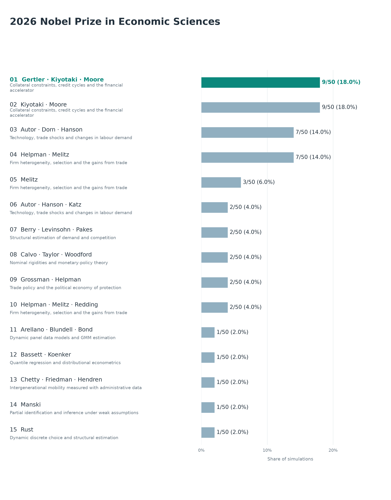
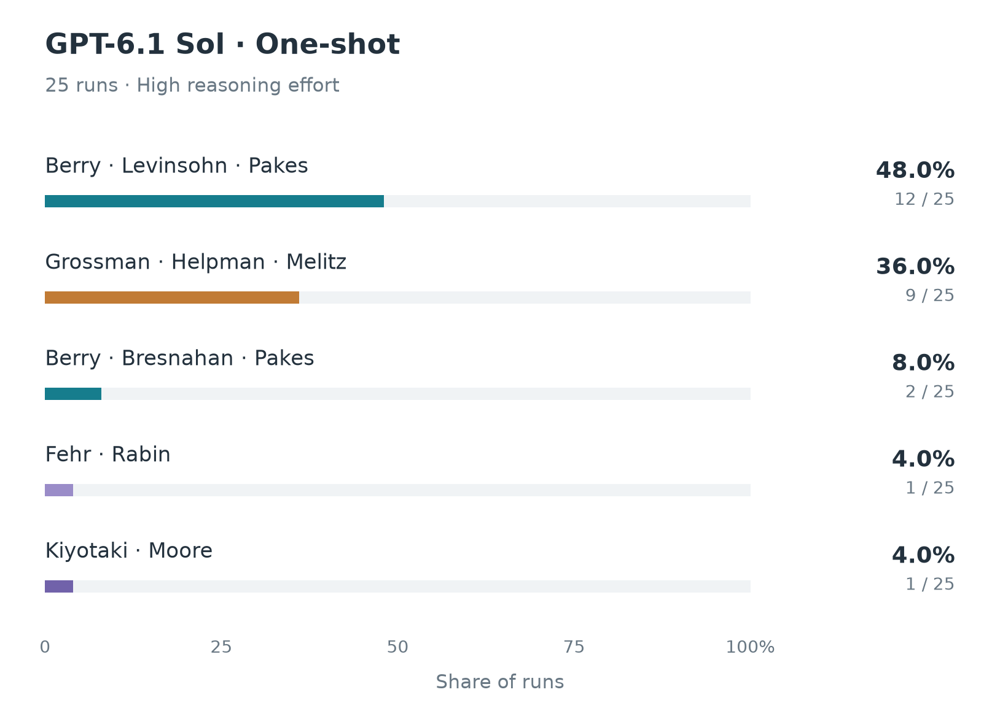
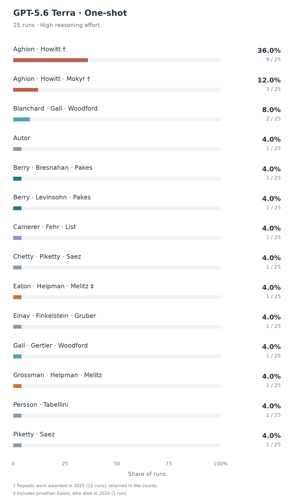
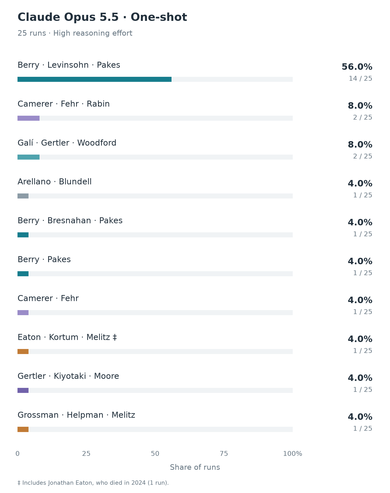
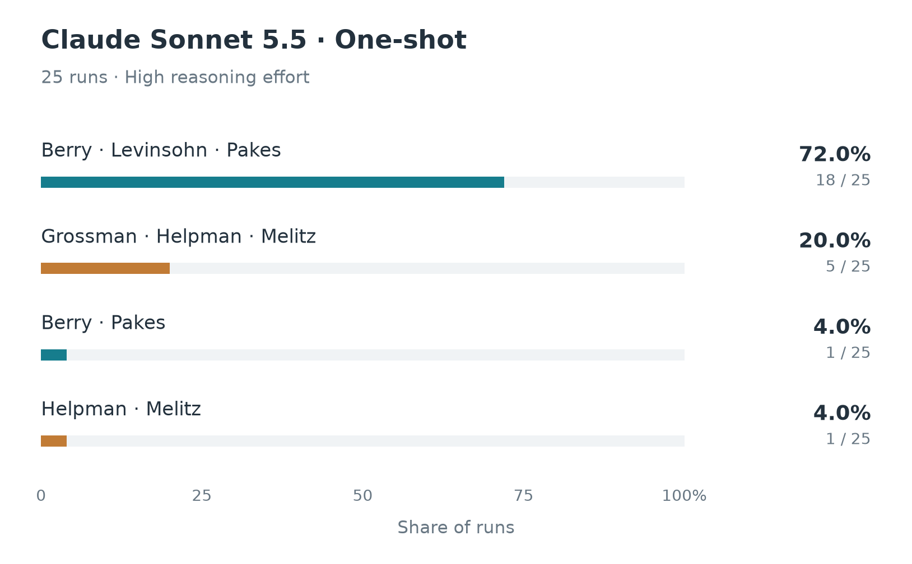
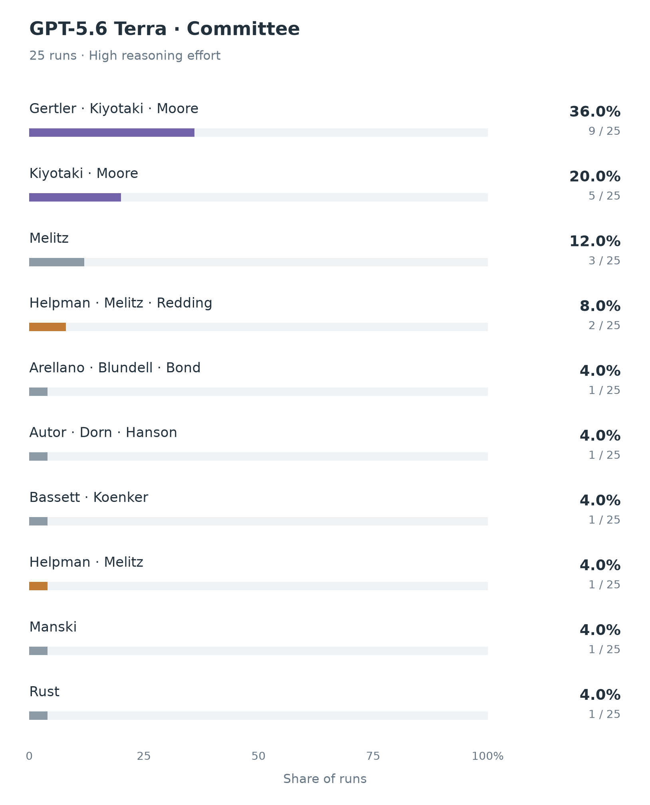
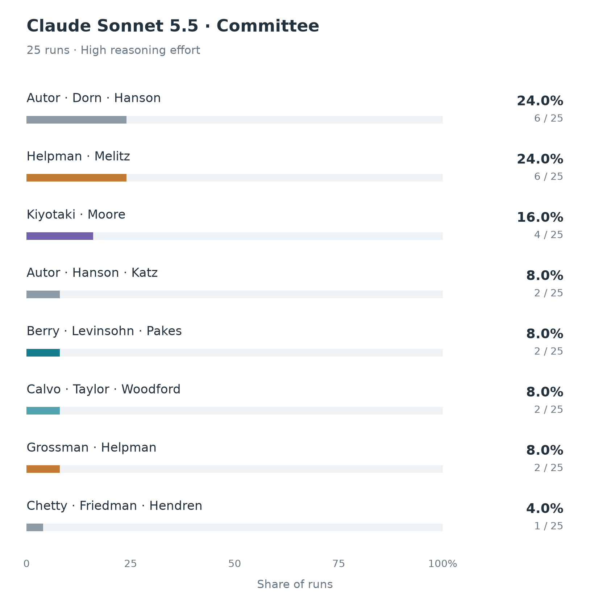

# Economics predictions for 2026

All four one-shot batches are complete: **100 predictions**, with **25 runs per model**. The committee comparison also contains **50 completed simulations**, split equally between GPT-5.6 Terra and Claude Sonnet 5.5. Every arm uses **high reasoning effort**.

The most frequent one-shot prediction is Berry–Levinsohn–Pakes for Sol (48%), Opus (56%) and Sonnet (72%). Terra instead favors Aghion–Howitt for growth theory (36%), with another 12% adding Mokyr; those answers repeat work already awarded in 2025. Committee deliberations favor different contributions: Terra selects credit-cycle research in 56% of its decisions, while Sonnet selects labour-market research in 32% and heterogeneous-firm trade in 24%.

[Candidate list](../../agent-data/economics/candidates/README.md) · [Canonical candidates](../../agent-data/economics/candidates/candidates.json) · [Candidate CSV](../../agent-data/economics/candidates/candidates.csv) · [Experiment design](../../docs/ECONOMICS_EXPERIMENT_DESIGN.md)

## Aggregate simulation outcomes

The figure shows all **15 winning configurations across 50 committee simulations**. Each completed decision has equal weight; alternate recipient configurations remain separate. The [main Economics forecast](../../README.md#economic-sciences) shows the top five in the same format as the other prizes. Ties are ordered alphabetically by abbreviated figure label.



## Four one-shot results

The four figures show every primary recipient configuration in each 25-run batch. All use the same 0–100% scale. Surnames abbreviate the full names in the tables below; † marks the already-awarded growth work and ‡ marks a prediction including Jonathan Eaton. Flagged answers remain in the counts.

<table>
  <tr>
    <td align="center" valign="top"></td>
    <td align="center" valign="top"></td>
  </tr>
  <tr>
    <td align="center"><strong>GPT-6.1 Sol</strong></td>
    <td align="center"><strong>GPT-5.6 Terra</strong></td>
  </tr>
  <tr>
    <td align="center" valign="top"></td>
    <td align="center" valign="top"></td>
  </tr>
  <tr>
    <td align="center"><strong>Claude Opus 5.5</strong></td>
    <td align="center"><strong>Claude Sonnet 5.5</strong></td>
  </tr>
</table>

| Model | Reasoning effort | Completed runs | Leading recipient configuration | Runs | Share |
|---|---|---:|---|---:|---:|
| GPT-6.1 Sol | High | 25 | Ariel Pakes, James Levinsohn, Steven Berry | 12 | 48% |
| GPT-5.6 Terra | High | 25 | Peter Howitt, Philippe Aghion | 9 | 36% |
| Claude Opus 5.5 | High | 25 | Ariel Pakes, James Levinsohn, Steven Berry | 14 | 56% |
| Claude Sonnet 5.5 | High | 25 | Ariel Pakes, James Levinsohn, Steven Berry | 18 | 72% |

Each table below groups the **primary recipient configuration**, regardless of name order. Contribution labels summarize the recorded answers; exact contribution wording and rationales remain in the linked source records. Different recipient combinations stay separate. Every table totals 25, including factually problematic predictions. Frequencies describe repeated model outputs, not calibrated probabilities of the actual prize.

For the Claude tables, the explicit aliases `Steven T. Berry → Steven Berry`, `Gene Grossman → Gene M. Grossman`, and `Marc Melitz → Marc J. Melitz` are combined. This merges Sonnet's Berry trio from 17 + 1 to 18 and its Helpman–Grossman–Melitz trio from 4 + 1 to 5. The GPT tables use the aliases already documented in their linked summaries. Raw records are unchanged.

### GPT-6.1 Sol — 25 one-shot predictions

| Primary recipients | Contribution summarized from the answers | Runs | Share |
|---|---|---:|---:|
| Ariel Pakes, James Levinsohn, Steven Berry | Structural empirical industrial organization: demand, market power and competition | 12 | 48% |
| Elhanan Helpman, Gene M. Grossman, Marc J. Melitz | International trade, firm heterogeneity and trade policy | 9 | 36% |
| Ariel Pakes, Steven Berry, Timothy Bresnahan | Structural empirical industrial organization: demand, market power and competition | 2 | 8% |
| Ernst Fehr, Matthew Rabin | Behavioral and experimental economics, social preferences | 1 | 4% |
| John Moore, Nobuhiro Kiyotaki | Credit constraints, financial frictions and macroeconomic fluctuations | 1 | 4% |

The Berry–Levinsohn–Pakes trio leads with 12 runs. Another two choose Berry–Pakes–Bresnahan, taking empirical industrial organization to 14/25 (56%) across recipient variants. Helpman–Grossman–Melitz accounts for nine runs (36%).

[Aggregate summary and run IDs](oneshot/gpt-6.1-sol/summary.json) · [Exact source-bound transcriptions](oneshot/gpt-6.1-sol/transcriptions.json) · [Raw answers and execution records](oneshot/gpt-6.1-sol/)

### GPT-5.6 Terra — 25 one-shot predictions

| Primary recipients | Contribution summarized from the answers | Runs | Share |
|---|---|---:|---:|
| Peter Howitt, Philippe Aghion | Innovation-driven growth and creative destruction † | 9 | 36% |
| Joel Mokyr, Peter Howitt, Philippe Aghion | Innovation-driven growth and creative destruction; historical foundations of technological progress † | 3 | 12% |
| Jordi Galí, Michael Woodford, Olivier Blanchard | New Keynesian macroeconomics and monetary policy | 2 | 8% |
| Amy Finkelstein, Jonathan Gruber, Liran Einav | Empirical health economics, insurance and market design | 1 | 4% |
| Ariel Pakes, James Levinsohn, Steven Berry | Structural empirical industrial organization: demand, market power and competition | 1 | 4% |
| Ariel Pakes, Steven Berry, Timothy Bresnahan | Structural empirical industrial organization: demand, market power and competition | 1 | 4% |
| Colin Camerer, Ernst Fehr, John List | Behavioral and experimental economics, social preferences | 1 | 4% |
| David Autor | Globalization, automation, employment and wage inequality | 1 | 4% |
| Elhanan Helpman, Gene Grossman, Marc Melitz | International trade, firm heterogeneity and trade policy | 1 | 4% |
| Elhanan Helpman, Jonathan Eaton, Marc Melitz | International trade, firm heterogeneity and trade policy ‡ | 1 | 4% |
| Emmanuel Saez, Raj Chetty, Thomas Piketty | Inequality, taxation and intergenerational mobility | 1 | 4% |
| Emmanuel Saez, Thomas Piketty | Income and wealth inequality, taxation | 1 | 4% |
| Guido Tabellini, Torsten Persson | Political economy and the economic effects of institutions | 1 | 4% |
| Jordi Galí, Mark Gertler, Michael Woodford | New Keynesian macroeconomics and monetary policy | 1 | 4% |

This arm matches the Terra committee agents' model and reasoning effort. **13/25 answers carry observed factual flags:** 12 repeat already-awarded growth work (†), and one includes Jonathan Eaton (‡). The primary-pick table excludes conditional alternatives: for example, [pred-019](oneshot/gpt-5.6-terra/pred-019/response.txt) primarily selects Autor alone and mentions Autor–Dorn–Hanson only if the prize is shared.

[Summary, run IDs and factual flags](oneshot/gpt-5.6-terra/summary.json) · [Exact source-bound transcriptions](oneshot/gpt-5.6-terra/transcriptions.json) · [Raw answers and execution records](oneshot/gpt-5.6-terra/) · [Terra arm notes](oneshot/gpt-5.6-terra/README.md)

### Claude Opus 5.5 — 25 one-shot predictions

| Primary recipients | Contribution summarized from the answers | Runs | Share |
|---|---|---:|---:|
| Ariel Pakes, James Levinsohn, Steven Berry | Structural empirical industrial organization: demand, market power and competition | 14 | 56% |
| Colin Camerer, Ernst Fehr, Matthew Rabin | Behavioral and experimental economics, social preferences | 2 | 8% |
| Jordi Galí, Mark Gertler, Michael Woodford | New Keynesian macroeconomics and monetary policy | 2 | 8% |
| Ariel Pakes, Steven Berry | Structural empirical industrial organization: demand, market power and competition | 1 | 4% |
| Ariel Pakes, Steven Berry, Timothy Bresnahan | Structural empirical industrial organization: demand, market power and competition | 1 | 4% |
| Colin Camerer, Ernst Fehr | Behavioral and experimental economics, social preferences | 1 | 4% |
| Elhanan Helpman, Gene M. Grossman, Marc J. Melitz | International trade, firm heterogeneity and trade policy | 1 | 4% |
| John Moore, Mark Gertler, Nobuhiro Kiyotaki | Credit constraints, financial frictions and macroeconomic fluctuations | 1 | 4% |
| Jonathan Eaton, Marc J. Melitz, Samuel Kortum | International trade, firm heterogeneity and trade policy ‡ | 1 | 4% |
| Manuel Arellano, Richard Blundell | Panel-data microeconometrics and household behavior | 1 | 4% |

The Berry–Levinsohn–Pakes trio leads with 14 runs (56%). Including the Berry–Pakes–Bresnahan trio and Berry–Pakes pair, empirical industrial organization appears in 16/25 predictions (64%). One answer, [pred-09](oneshot/claude-opus-5-5/pred-09.json), proposes Jonathan Eaton with Melitz and Kortum (‡).

[All 25 structured predictions](oneshot/claude-opus-5-5/) · [Raw execution streams](oneshot/claude-opus-5-5/runtime/) · [Prompt and output schema](../../prompts/economics_oneshot_claude_v1.md)

### Claude Sonnet 5.5 — 25 one-shot predictions

| Primary recipients | Contribution summarized from the answers | Runs | Share |
|---|---|---:|---:|
| Ariel Pakes, James Levinsohn, Steven Berry | Structural empirical industrial organization: demand, market power and competition | 18 | 72% |
| Elhanan Helpman, Gene M. Grossman, Marc J. Melitz | International trade, firm heterogeneity and trade policy | 5 | 20% |
| Ariel Pakes, Steven Berry | Structural empirical industrial organization: demand, market power and competition | 1 | 4% |
| Elhanan Helpman, Marc J. Melitz | International trade, firm heterogeneity and trade policy | 1 | 4% |

The Berry–Levinsohn–Pakes trio leads with 18 runs (72%). Its Berry–Pakes pair adds one run, giving empirical industrial organization 19/25 (76%). The other six runs favor international trade: five select Helpman–Grossman–Melitz and one selects Helpman–Melitz.

[All 25 structured predictions](oneshot/claude-sonnet-5-5/) · [Raw execution streams](oneshot/claude-sonnet-5-5/runtime/) · [Prompt and output schema](../../prompts/economics_oneshot_claude_v1.md)

### Factual flags retained in the results

† The [2025 Economics prize](https://www.nobelprize.org/prizes/economic-sciences/2025/press-release/) recognized Mokyr, Aghion and Howitt for innovation-driven growth. Terra's 12 flagged growth answers repeat that recognized work. The flag concerns the proposed contribution, rather than a blanket exclusion of previous laureates.

‡ [Jonathan Eaton died in 2024](https://www.bu.edu/econ/?p=34458). He appears in Terra's [pred-002](oneshot/gpt-5.6-terra/pred-002/response.txt) and Opus's [pred-09](oneshot/claude-opus-5-5/pred-09.json).

These flags describe factual problems in successful model responses. They do not trigger retries, remove predictions or change the denominator. The documented review focuses on the repeated 2025 growth award and Eaton's death.

### One-shot protocol

Each run starts a fresh tools-disabled session and receives no candidate list, committee profiles, deliberations or earlier predictions. One-shots can name people outside the committee's 50-contribution pool. All four models receive the same user question:

> Who will win the 2026 Nobel Prize in Economic Sciences? Predict the prize: the contribution, and the one to three laureates. Answer from your own knowledge only; do not search the web or read any files.

The [Sol prompt](../../prompts/economics_oneshot_gpt_6_1_sol_v1.txt) and [Terra prompt](../../prompts/economics_oneshot_gpt_5_6_terra_v1.txt) are byte-identical. GPT answers are preserved as free-form responses and transcribed using exact supporting excerpts. Claude adds a formatting-only system instruction requiring JSON fields `contribution`, `laureates` and `rationale`; its answers are saved directly as structured records. The shared user question does not make the provider system instructions identical.

The OpenAI execution manifests ([Sol](oneshot/gpt-6.1-sol/manifest.json), [Terra](oneshot/gpt-5.6-terra/manifest.json)) retain request and source identities. The [Claude runner](../../scripts/run_oneshot_claude.py) records the requested model and high effort, validates one to three laureates, checks model identity and absence of tool use, and retains raw attempts in each arm's `runtime/` directory.

## Committee results

<table>
  <tr>
    <td align="center" valign="top"></td>
    <td align="center" valign="top"></td>
  </tr>
  <tr>
    <td align="center"><strong>GPT-5.6 Terra</strong></td>
    <td align="center"><strong>Claude Sonnet 5.5</strong></td>
  </tr>
</table>

Each model completes 25 simulations using the same 50-contribution pool and five neutral factual profile versions, with five repetitions per version. The four additional versions change presentation while preserving the retained facts and public statements. [The profile manifest](../../agent-data/economics/committee/terra_profile_variants.json) records the generated profiles and source hashes; the `terra` filename is also used for the shared Claude inputs.

All 11 roster participants vote **by modeling assumption**, with John Hassler chairing and a majority of six. This does not establish actual voting rights. The protocol comprises opening rankings, deterministic shortlisting, two discussion rounds with a chair summary, and private final ballots resolved by instant-runoff voting. Each complete simulation uses 45 accepted model responses. Candidate presentation is shuffled and IDs are blinded.

The following tables preserve distinct contribution-and-recipient configurations. Because each of the five profile versions contributes five completed simulations, pooled shares also equal the summaries' equally weighted profile shares.

### GPT-5.6 Terra — 25 committee simulations

| Contribution | Recipients | Decisions | Share |
|---|---|---:|---:|
| Collateral constraints, credit cycles and the financial accelerator | John Moore, Mark Gertler, Nobuhiro Kiyotaki | 9 | 36% |
| Collateral constraints, credit cycles and the financial accelerator | John Moore, Nobuhiro Kiyotaki | 5 | 20% |
| Firm heterogeneity, selection and the gains from trade | Marc J. Melitz | 3 | 12% |
| Firm heterogeneity, selection and the gains from trade | Elhanan Helpman, Marc J. Melitz, Stephen J. Redding | 2 | 8% |
| Quantile regression and distributional methods in econometrics | Gilbert Bassett Jr., Roger W. Koenker | 1 | 4% |
| Firm heterogeneity, selection and the gains from trade | Elhanan Helpman, Marc J. Melitz | 1 | 4% |
| Dynamic panel data models and GMM estimation | Manuel Arellano, Richard Blundell, Stephen R. Bond | 1 | 4% |
| Partial identification, moment inequalities and credible inference under weak assumptions | Charles F. Manski | 1 | 4% |
| Technology, trade shocks, tasks and changes in labour demand and wage inequality | David Dorn, David H. Autor, Gordon H. Hanson | 1 | 4% |
| Dynamic discrete choice and the structural estimation of dynamic programming models | John Rust | 1 | 4% |

[Summary and profile breakdowns](terra_committee_summary.json) · [Decisions and deliberations](committee/gpt-5.6-terra/)

### Claude Sonnet 5.5 — 25 committee simulations

| Contribution | Recipients | Decisions | Share |
|---|---|---:|---:|
| Technology, trade shocks, tasks and changes in labour demand and wage inequality | David Dorn, David H. Autor, Gordon H. Hanson | 6 | 24% |
| Firm heterogeneity, selection and the gains from trade | Elhanan Helpman, Marc J. Melitz | 6 | 24% |
| Collateral constraints, credit cycles and the financial accelerator | John Moore, Nobuhiro Kiyotaki | 4 | 16% |
| Nominal rigidities, the New Keynesian framework and the modern theory of monetary policy | Guillermo A. Calvo, John B. Taylor, Michael Woodford | 2 | 8% |
| Trade policy, special-interest politics and political-economy models of protection | Elhanan Helpman, Gene M. Grossman | 2 | 8% |
| Structural estimation of demand, competition and dynamic industry models | Ariel Pakes, James A. Levinsohn, Steven T. Berry | 2 | 8% |
| Technology, trade shocks, tasks and changes in labour demand and wage inequality | David H. Autor, Gordon H. Hanson, Lawrence F. Katz | 2 | 8% |
| Intergenerational mobility measured with population administrative data | John N. Friedman, Nathaniel Hendren, Raj Chetty | 1 | 4% |

[Summary and profile breakdowns](claude_committee_summary.json) · [Decisions and deliberations](committee/claude-sonnet-5-5/)

### Comparing committees with one-shots

Terra's committee selects credit constraints and the financial accelerator in 14/25 decisions (56%), whereas its one-shot outputs center on already-awarded growth research. Sonnet's committee selects labour-market research in 8/25 decisions (32%) and heterogeneous-firm trade in 6/25 (24%); its one-shots concentrate on Berry–Levinsohn–Pakes (72%), a trio selected by only 2/25 Sonnet committees (8%).

The differences reflect the full change in setup: committees receive a curated candidate pool, factual participant profiles, discussion and a voting procedure. They therefore cannot be attributed to deliberation alone. Sol and Opus provide additional one-shot comparisons; there are no Sol or Opus Economics committee batches in this experiment.

## Figure reproduction

Regenerate all eight figures from the saved results with:

```sh
python3 scripts/plot_economics_prediction_distributions.py
```

The [plotting script](../../scripts/plot_economics_prediction_distributions.py) checks both committee summaries against all 50 saved decisions, checks GPT one-shot counts against their primary-pick records and source hashes, and counts all 25 structured answers in each Claude arm using the documented aliases. The [figure-data manifest](figure_data.json) records the plotted counts, ordering and input hashes. No additional model calls or prediction filtering are involved.
